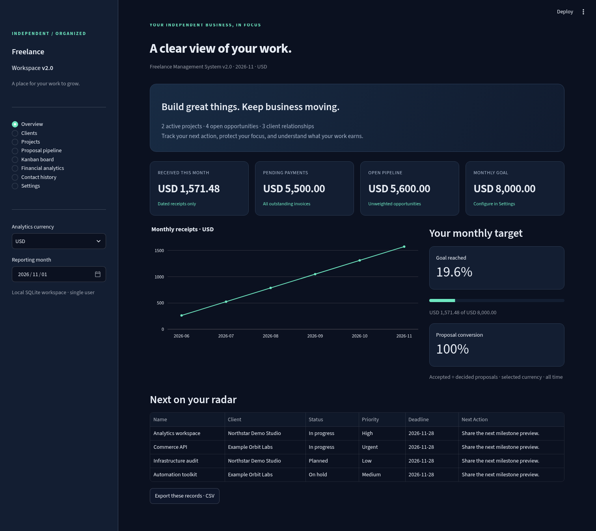
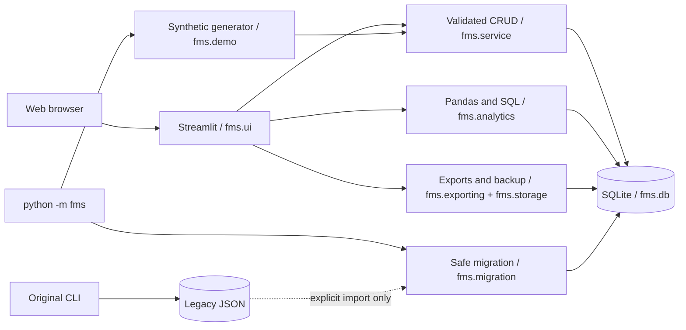
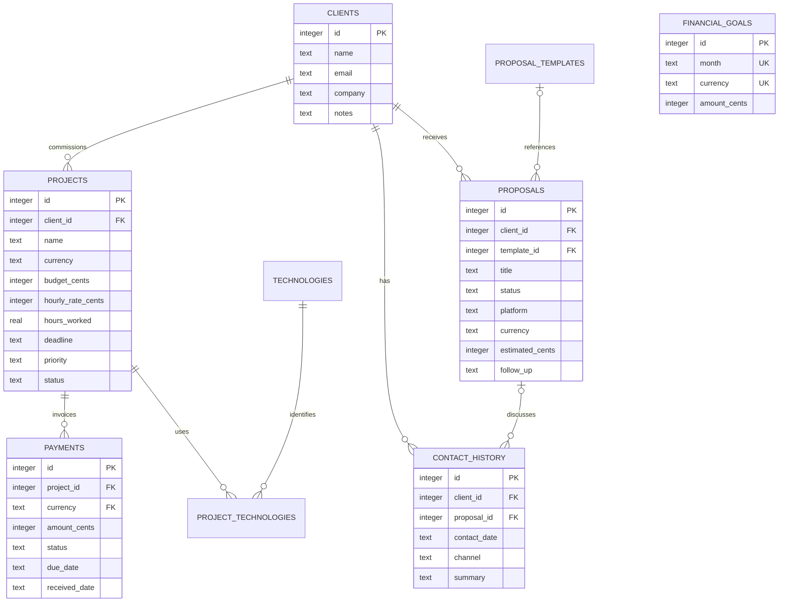
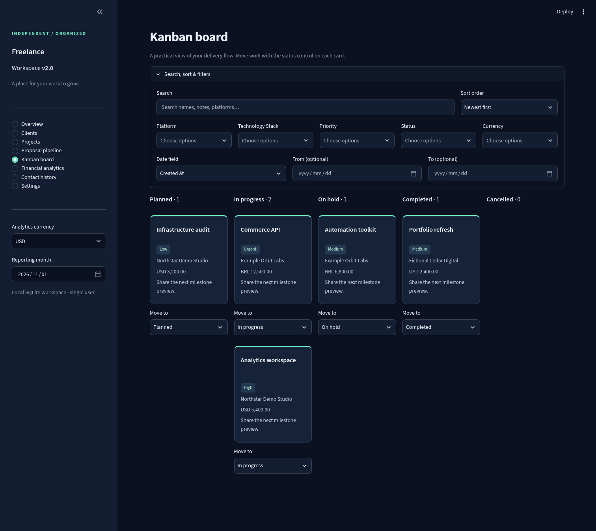
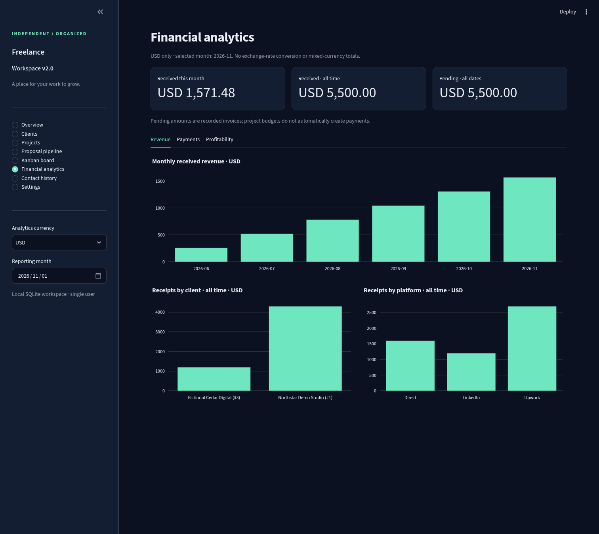

# Freelance Management System v2.0

A local freelance CRM and project management platform for independent developers and IT professionals. Manage client relationships, delivery, proposals, payments, and monthly goals from a dark navy Streamlit workspace.

The original Portuguese command-line application remains available. v2 adds a relational database and web interface without automatically importing, rewriting, or synchronizing the CLI's JSON data.



## Features

- **Client CRM:** create, view, edit, search, and delete clients; retain company details, notes, and a dated contact history.
- **Project management:** client, description, normalized technology stack, platform, budget, currency, hourly rate, hours worked, optional deadline, priority, status, notes, and next action.
- **Proposal pipeline:** opportunity identified → proposal submitted → awaiting response → negotiation → accepted or rejected; reusable editable templates, follow-up dates, platform, estimated revenue, and linked contact records. Stages can be changed directly.
- **Kanban:** project cards grouped by delivery status; move cards with their status selectors.
- **Financial analytics:** monthly and all-time receipts, pending invoices, open pipeline estimates, per-client and per-platform revenue, monthly goals, proposal conversion, and estimated project profitability.
- **Discovery:** search, sorting, and applicable platform, technology, priority, status, currency, and date filters. Date filtering excludes undated records when a range is selected.
- **Portability:** filtered CSV exports, a multi-sheet Excel workbook, consistent SQLite backups, validated restore into a new file, and a deterministic synthetic demo generator.
- **Quality:** validated service operations, parameterized SQL values, relational constraints, transactional writes, privacy-conscious logging, integrity checks, pytest tests, and GitHub Actions.

## Technology stack

Python **3.12**, SQLite (Python standard library), Streamlit, Pandas, Plotly, and openpyxl. Development tools: pytest, pytest-cov, and Ruff. Runtime dependencies live in `requirements.txt`; development dependencies are in `requirements-dev.txt`.

## Architecture



```text
app.py                       Streamlit entry point
freelancer_manager.py        Preserved v1 CLI with safer saves and monthly receipts
fms/
  db.py                      Connections, schema, indexes, integrity checks
  service.py                 Input validation and transactional CRUD
  analytics.py               Currency-scoped financial calculations
  ui.py                      Navigation, forms, charts, tables, Kanban
  migration.py               Explicit JSON-to-SQLite migration
  storage.py                 Validated, non-overwriting backup and restore
  exporting.py               CSV / Excel serialization
  demo.py                    Fictional demonstration data
  __main__.py                Administrative commands
tests/                       CRUD, finance, migration, storage, export, CLI, UI tests
.streamlit/config.toml       Navy theme and localhost configuration
.github/workflows/ci.yml     Python 3.12 lint, format and test checks
```

## Database schema



`financial_goals` has a **composite unique constraint on `(month, currency)`**. `migration_runs` records a source SHA-256 digest and imported record count. Full schema: [`fms/db.py`](fms/db.py).

Every connection enables foreign keys. Composite keys ensure a payment uses its project's currency and a proposal contact belongs to that proposal's client. Linked clients, projects with invoices, and proposals with contacts cannot be deleted accidentally. Removing a project removes only its technology associations. Deleting a template clears the optional reference and preserves proposal content. Indexes support client relationships, pipeline filters, receipt months, contact dates, and technology joins. Monetary amounts are integer cents; service methods use Decimal rounding at the input boundary. SQL identifiers come from internal allowlists; record values use placeholders.

## Installation

```bash
git clone https://github.com/Lpinheirowvski/freelance-management-system.git
cd freelance-management-system
python3.12 -m venv .venv
source .venv/bin/activate
python -m pip install -r requirements.txt
```

On Windows, create the environment with `py -3.12 -m venv .venv` and activate it with `.venv\Scripts\Activate.ps1` in PowerShell.

### Start an empty workspace

```bash
streamlit run app.py
```

Open **http://localhost:8501**. By default, the app creates `data/freelance.sqlite3`. Override the path with `FMS_DB`:

```bash
FMS_DB=data/my-workspace.sqlite3 streamlit run app.py
```

PowerShell:

```powershell
$env:FMS_DB = "data/my-workspace.sqlite3"
streamlit run app.py
```

### Try the synthetic demonstration

```bash
python -m fms demo --db data/demo.sqlite3
FMS_DB=data/demo.sqlite3 streamlit run app.py
```

This creates fictional clients, five projects in both currencies, six proposal stages, templates, contacts, installments, and goals for the current month. All email addresses use `example.com`. The command refuses an existing destination; choose another filename to create a fresh demo.

### Keep using the original CLI

```bash
python freelancer_manager.py
```

The CLI still uses `freelancers.json` relative to its working directory and keeps its Portuguese menu. New receipts include `data_pagamento`. It now saves atomically, refuses unreadable JSON, and calculates monthly goal progress using only dated receipts in the current month. Older undated receipts remain visible in all-time totals. CLI and web workspaces are independent after migration.

## Safe migration from v1

Stop the CLI before importing and keep an independent copy of its data. Migration is an explicit administrative operation:

```bash
python -m fms migrate --source freelancers.json --db data/migrated.sqlite3
python -m fms check --db data/migrated.sqlite3
FMS_DB=data/migrated.sqlite3 streamlit run app.py
```

The importer accepts the original list of records with `id`, `nome`, `projeto`, `horas`, `valor_hora`, `total`, `pago`, and `data` (`DD/MM/YYYY`), plus an optional `data_pagamento` in the same date format.

- The source JSON is never modified. An exact SHA-tagged `.bak` copy is kept beside it with owner-only file permissions on POSIX systems.
- Import happens in a staged database. Publication occurs only after all records and integrity checks pass. An existing destination is always refused, including a repeated run.
- Clients are grouped by their exact trimmed names; each original row becomes a project and one payment. Legacy IDs are retained in project notes; a source digest is recorded in `migration_runs`.
- v1 amounts are USD. Stored totals are preserved rather than recalculated from hours and rate. Additional legacy fields remain in the untouched source and its backup.
- v1 did not record payment dates. A paid record without `data_pagamento` is migrated as an **undated received payment**. Its project creation date is never substituted. Add the actual receipt date in Financial analytics → Payments when known.
- Malformed input, duplicate legacy IDs, invalid relationships, negative values, and non-finite hours/amounts prevent publication. No records are silently skipped.

## Usage

1. Add a client in **Clients**, then create projects in **Projects**. Expand the editor and select “New record” or an existing record to create or update it. Deletion requires its confirmation checkbox and respects linked records.
2. Capture opportunities in **Proposal pipeline**. Use the **Templates** tab to create or copy proposal text. Record conversations in **Contact history**, optionally linking them to the client's proposal.
3. Review and move delivery work on the **Kanban board**. Status movement uses a select control; drag-and-drop is not implemented.
4. Add invoices or installments in **Financial analytics → Payments**. Select the project, amount, status, and actual received date. Budgets do not automatically generate invoices.
5. Select a reporting month and currency in the sidebar. Set or remove the corresponding monthly goal in **Settings**.
6. Export filtered tables as CSV, or download the complete workbook from **Settings**. Monetary export columns ending in `_cents` contain integer minor units; display tables show currency amounts. Technology associations are included in separate workbook sheets. Exports are reporting files, not restore inputs. Spreadsheet formula-like text is escaped.

### Financial definitions

| Metric | Definition |
| --- | --- |
| Monthly revenue / goal progress | Received payments whose **received date** falls in the selected calendar month; goal progress is this amount divided by that month's currency-specific goal. |
| Received payments | All received payments in the selected currency, including undated legacy receipts. |
| Pending payments | All recorded pending invoices in the selected currency, regardless of due date. |
| Estimated revenue | Unweighted sum of open proposals; accepted and rejected proposals are excluded. This is a pipeline estimate, not booked revenue. |
| Client / platform revenue | All-time received payments, including undated receipts, grouped by project client or platform. |
| Proposal conversion | Accepted ÷ (accepted + rejected), for all-time proposals in the selected currency. No decided proposals displays “—”. |
| Project profitability | Budget minus hours worked × hourly rate; also shows surplus margin and budget ÷ hours. Zero budgets/hours have no defined margin/effective rate. |

The hourly rate represents the freelancer's labor value for this estimate. Profitability excludes taxes, fees, other expenses, and cash collection timing. USD and BRL are always separate. **There is no currency conversion.** The reporting month affects monthly receipts and goals; metrics labeled “all time,” pending invoices, open pipeline, and profitability are not month-filtered.

### Backup and restore

Use Settings to download a SQLite snapshot, upload a v2 SQLite backup, or run integrity checks. Restore always creates a **new** file. Stop the app and set `FMS_DB` to the restored path before restarting; the active database is never replaced.

The same operations are available from the terminal:

```bash
python -m fms backup --source data/freelance.sqlite3 --destination backups/workspace-2026-11-16.sqlite3
python -m fms restore --source backups/workspace-2026-11-16.sqlite3 --destination data/restored.sqlite3
python -m fms check --db data/restored.sqlite3
```

Backups use SQLite's online backup API, which gives a consistent snapshot. Restore validates the schema version, exact application schema, SQLite integrity, and foreign keys; foreign schemas, triggers, and damaged files are rejected. Export/backup commands refuse to overwrite any existing destination.

### Privacy and deployment scope

This is a **single-user local application**, bound to `127.0.0.1` by default. Authentication, access control, encryption, and hosted multi-user deployment are future work. Use it on a trusted machine. Logs contain operation/entity names and sanitized storage failure types, rather than client records. No user database, JSON file, export, backup, or local log is committed; `.gitignore` excludes the standard paths and formats. Keep private material in those ignored locations. Screenshots in this repository show only generated fictional data.

## Testing

```bash
python -m pip install -r requirements-dev.txt
python -m ruff check .
python -m ruff format --check .
python -m pytest --cov=fms --cov=freelancer_manager --cov-report=term-missing
```

Tests use temporary databases and synthetic fixtures. They cover CRUD and relational restrictions; exact money rounding, month boundaries, currency separation, and unknown receipt dates; migration preservation and rollback; backup validation and restore; safe exports; legacy CLI behavior; and real Streamlit script runs with form submissions and Kanban movement. GitHub Actions runs the same lint, formatting, and pytest commands on Python 3.12 for pushes and pull requests.

Screenshots below are actual browser captures of the running application with synthetic data, not design mockups.





## Current limitations and future improvements

- Add authentication and authorization before considering hosted, multi-user use; SQLite is currently intended for a local workload.
- Add invoices, expenses, taxes, platform fees, and billable/non-billable time to extend the planning estimate into fuller accounting.
- Add automated reminders, calendar integrations, proposal-to-project conversion, and drag-and-drop Kanban.
- Add an explicit exchange-rate ledger if converted reports are needed; currency totals remain separate today.
- Add schema upgrade migrations for future versions. The current importer supports the original v1 JSON format only, and restore supports this v2 schema only.
- The CLI and web database have no two-way synchronization. Keep one source of truth after importing.
- Browser layout validation covers the supplied desktop environment; broader mobile, accessibility, and cross-browser audits remain future work.

Developed by Lpinheirowvski.
